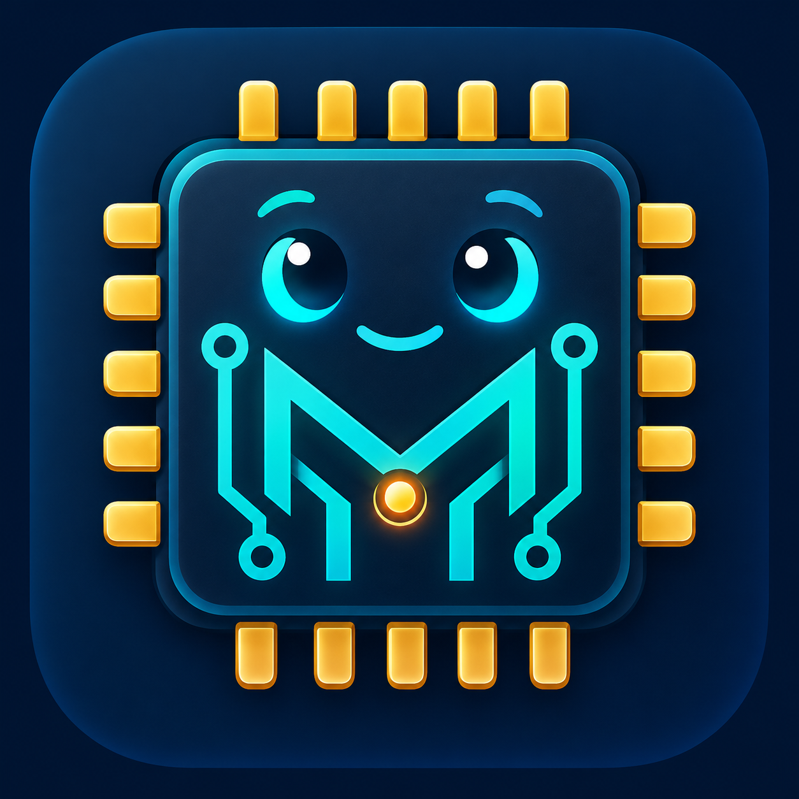

<p align="center">
  
</p>

# MicroPal

MicroPal brings a local MicroPython workflow for ESP32 and ESP32-S3 into VS Code and compatible Cursor releases. Select a board, see live serial output, run Python, edit its files directly in the Explorer, and install MicroPython from the official firmware catalog. Device operations share one serial ownership queue within the extension, so MicroPal waits for its current tool to close before another takes over.

[Source](https://github.com/Teachmetech/MicroPal) · [Report a bug](https://github.com/Teachmetech/MicroPal/issues) · [Changelog](CHANGELOG.md) · [Contributing](CONTRIBUTING.md) · [Publisher setup](docs/publisher-setup.md)

**Release status:** MicroPal is an early development extension. Use [GitHub Releases](https://github.com/Teachmetech/MicroPal/releases) for versioned VSIX downloads and release notes, or build from source. Visual Studio Marketplace and Open VSX publication is configured but awaits publisher registration and authentication; neither store listing is published yet. See the [verification record](docs/verification.md) for completed checks and the [manual acceptance checklist](docs/manual-testing.md) for outstanding editor, platform, and hardware checks.

## Contents

- [Quick start](#quick-start)
- [Features](#features)
- [Requirements and platform support](#requirements-and-platform-support)
- [Install MicroPal](#install-micropal)
- [Set up tools](#set-up-tools)
- [External tools](#external-tools-advanced)
- [Install and flash firmware](#install-and-flash-firmware)
- [Daily workflow](#daily-workflow)
- [Edit and transfer ESP32 files](#edit-and-transfer-esp32-files)
- [Serial ownership and reconnect](#serial-ownership-and-reconnect)
- [Commands](#commands)
- [Settings](#settings)
- [Troubleshooting and limits](#troubleshooting-and-limits)
- [Development and releases](#development-and-releases)
- [Contributing](#contributing)

## Quick start

1. [Install MicroPal](#install-micropal), install Python 3.10+ with `venv` and `ensurepip`, and open a trusted local project folder.
2. Run **MicroPal: Set Up Tools** from the Command Palette. This explicitly installs MicroPal's private mpremote and esptool environment.
3. Plug in your ESP32 or ESP32-S3 with a data-capable USB cable. If it needs MicroPython, follow [Install and flash firmware](#install-and-flash-firmware).
4. Run **MicroPal: Connect** and select the board's serial port. Close other serial clients first. The **MicroPal** Output channel opens automatically and receives live board output while the connection is idle.
5. Open a saved `.py` file and run **MicroPal: Run Current File**, or use **Upload Current File** / **Sync Project to Device** to store code on the board.
6. Use **MicroPal: Stop Execution** before browsing **ESP32 Files** in the Explorer. Double-click a device file and save to write it back. Use **MicroPal: Open REPL** when you need interactive input.

Run Current File executes a local file after a soft reset; it does not upload that file. Imported modules must already be on the device. Native Explorer drag can **move** the source; use the copy modifier or Copy/Paste when you want to keep it. See [Daily workflow](#daily-workflow) for details.

## Features

| Feature | What MicroPal provides | Behavior to know |
| --- | --- | --- |
| Connect and discover | Serial port discovery, USB/bridge candidates, explicit selection, and status reporting | A USB vendor match is a candidate, not proof of board type. |
| Live serial output | Automatically show the **MicroPal** Output channel and read board output after Connect | Uses managed Python, holds the idle port, and yields to commands; use REPL for interactive input. |
| Run Python | Run the current saved `.py` file with streamed Output | Starts with a soft reset; interactive input belongs in the REPL. |
| Upload and sync | Upload a file or preview and sync a project with exclusions | Matching remote files are overwritten; other remote files remain. |
| Device Explorer | Writable **ESP32 Files** root, direct saves, new files/folders, rename, and delete | Requires an idle MicroPal session; device deletes are permanent. |
| File transfers | Native Copy/Paste and drag, plus explicit upload/download pickers | Pickers keep the source and reject an existing destination; native drag normally moves. |
| REPL and execution control | Real-terminal REPL, Stop Execution, and Soft Reset | Explicit actions can interrupt board code and take over an existing MicroPal session. |
| Reconnect | Rediscovery by USB serial identity, or exact selected path as fallback | Never reruns a file or replays an upload. |
| Serial-port recovery | On macOS/Linux, release surviving managed REPLs and offer consent for other owners | Windows uses manual close; force termination requires separate confirmation. |
| Firmware flashing | Choose an official MicroPython variant/version or a local BIN, then confirm an esptool 5.x flash | Downloads and flashing support cancellation; combined ESP32/S3 images use the correct default address and leave MicroPal disconnected. |
| Tool setup and repair | Private, version-pinned Python tools installed on an explicit action | Python is supplied by you; setup is never run on activation. |

Debugging, variable/GPIO inspection, WebREPL, remote SSH/containers, custom baud rates, and automatic code replay are outside the current scope.

## Requirements and platform support

- A desktop VS Code 1.95+ installation or a Cursor release with compatible extension APIs.
- Python 3.10+ with working `venv` and `ensurepip` modules, installed by you. MicroPal does not bundle Python.
- An ESP32 or ESP32-S3, a data-capable USB cable, and OS permission to use its serial device. Run/upload/REPL require MicroPython; flashing does not.
- Internet access to official PyPI during managed tool setup/repair, and to `micropython.org` when choosing official firmware. Installed tools and local firmware work offline.
- Node.js 22.22.2+ (or 24.15+) and npm to build from source.

The extension runs local tools on the computer running the editor UI. Close Thonny, serial monitors, other editor windows, and other clients using the board before connecting.

Supported interfaces and recorded verification are different:

| Area | Target support | Recorded verification |
| --- | --- | --- |
| Editor | Desktop VS Code 1.95+; Cursor with compatible VS Code APIs | macOS development-host smoke checks in VS Code 1.140.0 and Cursor API 1.128.0, plus isolated native filesystem fixtures. |
| Operating system | macOS, Windows, and Linux with local serial access | macOS arm64 checks are recorded. Windows/Linux hardware and interactive acceptance remain pending. |
| Board | ESP32 and ESP32-S3 running suitable MicroPython firmware | A real macOS serial-conflict recovery and subsequent MicroPython connection are recorded. Full physical-board run/upload/filesystem/REPL/flashing acceptance remains pending. |
| Python tools | Python 3.10+; managed mpremote 1.29.0 and esptool 5.0.2 | Real managed installation verified on macOS with Python 3.11.13. |
| Official firmware downloads | Stable combined BIN images for generic ESP32 and ESP32-S3 profiles | Real official catalogs and v1.29.0 downloads verified, including stored bytes and local SHA-256; physical flashing remains unverified. |
| Development runtime | Node.js 22.22.2+ (or 24.15+) and npm | Historical local checks used Node 26.7.0; CI and current results are documented separately. |

Consult the [verification record](docs/verification.md) for exact versions and scope. Passing unit tests or a fake-board editor fixture does not establish compatibility with every board, firmware, USB bridge, or operating system.

## Install MicroPal

### Visual Studio Marketplace and Open VSX

Both stores are planned release targets. The configured public extension identity is `teachmetech.micropal`; publisher registration and store listings must be verified before publication. This README will link to real listings after the first successful publication. Until then, install a locally built VSIX or a VSIX attached to a [GitHub release](https://github.com/Teachmetech/MicroPal/releases) when one is available.

### Install a VSIX

To build from source, clone the repository and use Node.js 22.22.2+ (or 24.15+):

```sh
git clone https://github.com/Teachmetech/MicroPal.git
cd MicroPal
npm ci
npm run check
npm run package
```

`check` runs TypeScript checking, linting, tests, and the bundle build. `package` creates a versioned `micropal-*.vsix` in the repository root. In VS Code or Cursor, run **Extensions: Install from VSIX…** and select that file. Then run **Developer: Reload Window** and confirm the installed version and logo in the extension's details. Settings use the `microPal.*` prefix.

### Update or migrate an installed copy

1. Run **MicroPal: Disconnect** before updating.
2. Run **Extensions: Install from VSIX…** and select the new package.
3. Run **Developer: Reload Window** after installation.

A newer VSIX with the same extension identity updates the existing installation and retains its settings and managed tool storage. Editing this repository does not update an installed extension; install the newly packaged VSIX each time.

Development builds have used the `micropal-local.micropal` identity. The public `teachmetech.micropal` identity is a separate extension: disconnect and disable or uninstall the old extension, then install the new one and run **Set Up Tools** to create its managed tool environment. Settings keep the same `microPal.*` names; check their values in User settings, especially any executable overrides. The earlier **ESP32 Workbench** identity (`esp32-workbench-local.esp32-workbench`) is also a separate extension and should be disabled or uninstalled before using MicroPal.

## Set up tools

1. Open a trusted workspace and run **MicroPal: Set Up Tools** (`microPal.setupTools`). If a device command needs tools that are missing, MicroPal offers this action; accepting it starts setup.
2. MicroPal detects a compatible Python installation. If needed, set **MicroPal: Python Path** (`microPal.pythonPath`) in User settings to a Python 3.10+ executable. Use an executable path, never a shell command such as `python -m ...`.
3. Setup disconnects MicroPal and waits for active device operations to close. It then creates a private virtual environment and downloads `mpremote==1.29.0` and `esptool==5.0.2`, with their dependencies, from official PyPI. Follow progress in the **MicroPal** Output channel; the progress notification supports cancellation.
4. After both tools pass version checks, MicroPal selects the new environment. Run **MicroPal: Connect** or **MicroPal: Flash Firmware** explicitly to continue.

Setup changes neither your global Python packages nor your system `PATH`. It stores tools in this extension's global storage directory, under `tools/`. Each `env-UUID` generation stays at its original path, and an atomically written `tools.json` selects the active generation. Activation itself never installs tools or makes network requests.

Use **MicroPal: Repair Tools** (`microPal.repairTools`) if the managed tools stop working. Repair creates and verifies a new generation before switching the active pointer. A failed or cancelled setup/repair preserves the previously active environment; previous successful generations are retained. Setup and repair disconnect active MicroPal device sessions, so reconnect afterward.

Leave **Mpremote Path** and **Esptool Path** empty to use managed tools. A nonempty value overrides the managed executable for that tool. Keep these machine-scoped settings in User settings; workspace files should not select executables on your computer.

## External tools (advanced)

You can install your own `mpremote >=1.24,<2` and `esptool >=5,<6` and set their executable paths explicitly. This bypasses the managed executable for each configured tool. An empty path selects managed tools, even if another installation is on `PATH`.

Use an isolated environment. With pipx already installed:

```sh
pipx install 'mpremote>=1.24,<2'
pipx install 'esptool>=5,<6'
```

Alternatively, on macOS or Linux:

```sh
python3 -m venv .venv
.venv/bin/python -m pip install 'mpremote>=1.24,<2' 'esptool>=5,<6'
.venv/bin/mpremote version
.venv/bin/esptool version
```

On Windows PowerShell:

```powershell
py -3 -m venv .venv
.venv\Scripts\python.exe -m pip install 'mpremote>=1.24,<2' 'esptool>=5,<6'
.venv\Scripts\mpremote.exe version
.venv\Scripts\esptool.exe version
```

Set **MicroPal: Mpremote Path** and **MicroPal: Esptool Path** in the editor's User settings to the absolute paths of those executables. Select the executables themselves, not `python -m mpremote`, `python -m esptool`, or shell commands. A GUI-launched editor may have a different `PATH` from your shell. See the [official mpremote documentation](https://docs.micropython.org/en/v1.29.0/reference/mpremote.html) for CLI usage.

The automatic serial console uses the private managed Python environment even when mpremote is overridden. Run **Set Up Tools** to enable that console; your executable overrides stay in effect. Without the managed environment, external-tool commands remain available and MicroPal reports the console requirement once. It never installs tools automatically.

## Install and flash firmware

Run **MicroPal: Set Up Tools** first, or configure your own esptool 5.x executable as described above.

1. Run **MicroPal: Flash Firmware** from the Command Palette or the device view's flame button. A MicroPython connection is not required. Select the serial port and the chip that matches your exact board.
2. Choose **Download official MicroPython** or **Use a local BIN file**. The official option fetches the [ESP32](https://micropython.org/download/ESP32_GENERIC/) or [ESP32-S3](https://micropython.org/download/ESP32_GENERIC_S3/) catalog. Choose the board's variant, then a stable version; the newest stable version appears first. Preview builds, UF2, ELF, and application-only files are excluded.
3. For an official image, follow the cancellable download progress. MicroPal uses the profile's installation address: `0x1000` for ESP32 and `0x0` for ESP32-S3. For a local BIN, select the file and enter the address supplied with that firmware; the same defaults are offered. This workflow accepts a single combined binary, not separate bootloader/application images.
4. Choose **Write firmware only** (replace the image's sectors) or **Erase entire flash** (delete all files/settings before writing). Review the chip, port, source/version, image, address, and erase mode in the final modal, then confirm **Flash Firmware**. Cancelling a picker or that confirmation never starts esptool; an official image may already have been downloaded.
5. Watch the **MicroPal** Output channel. On completion, reset the board if needed and run **MicroPal: Connect**. The extension stays disconnected after flashing, without replaying work.

The ESP32 catalog offers Standard, SPIRAM/WROVER, Unicore/SOLO, OTA, and D2WD variants. ESP32-S3 offers Standard and Octal PSRAM. Match the variant to the board's flash/PSRAM specifications; a USB port match cannot identify that configuration. Consult the manufacturer's instructions and the [official download pages](https://micropython.org/download/) when unsure.

Official downloads use exact HTTPS URLs on `micropython.org`, refuse redirects, and enforce response size and time limits. Complete downloads are stored atomically under extension global storage `firmware/`, with source/version metadata and a local SHA-256 record. Image size, ESP header magic, and chip ID are sanity checks. The local hash records the bytes downloaded; it is not an authenticated upstream checksum or a guarantee that the image suits your exact board. Opening the extension never fetches a catalog or downloads firmware.

Hold **BOOT** while pressing/releasing **RESET** if your board requires manual bootloader entry; follow its manufacturer's instructions. Bootloader USB may appear as a different port, so enter bootloader mode before selecting the port. Close Thonny and other serial clients first.

Cancel from the progress notification or choose **Disconnect** to stop esptool and wait for its process to release the port. An interrupted write or erase can leave incomplete firmware; run Flash Firmware again to recover. Each flash has a ten-minute deadline and uses 460800 baud, independently of mpremote's fixed 115200 rate. See the [official esptool commands](https://docs.espressif.com/projects/esptool/en/latest/esp32/esptool/basic-commands.html).

## Daily workflow

1. Open and trust your local MicroPython project folder. Plug in the board and run **MicroPal: Connect** from the Command Palette or the activity bar.
2. Select the port. Discovery uses `mpremote connect list`, backed by pyserial's port enumeration. A USB vendor/bridge match is a useful candidate, not proof that the connected device is an ESP32. With **Auto Show Output** enabled, Connect shows live serial output in the **MicroPal** Output channel. It receives output only while its reader owns the port; earlier output is not recovered.
3. Open a saved `.py` file and run **Run Current File**. This starts from a clean heap with a soft reset and executes the local file without saving it to the device. Imported project modules must already be uploaded. Output appears in the **MicroPal** Output channel; this mode does not accept interactive input.
4. Use **Upload Current File** to copy a saved file, or **Sync Project to Device** to upload the selected project. Sync saves open documents that already have file paths before planning uploads; save any untitled files separately first. Review the sync file count and size before confirming. Existing matching remote files are overwritten; other remote files remain.
5. Use **Stop Execution** to interrupt the board's program. Use **Open REPL** for interactive Python input in a real terminal, including normal mpremote/REPL control keys. Use **Soft Reset** to reboot the MicroPython interpreter. Stop and Soft Reset forward tool output to the **MicroPal** Output channel.
6. Stop an active Run session or close the REPL, then use **ESP32 Files** below your local folders in the Explorer to edit and manage device files. Use **Refresh Device Files** to see changes made outside MicroPal.

## Edit and transfer ESP32 files

Connecting adds **ESP32 Files** below your local workspace folders in the normal Explorer sidebar. If it is hidden, run **MicroPal: Open ESP32 Files in Explorer**. A local project folder must be open for this layout; Connect itself still works without one. Opening the device root changes the editor to a multi-root workspace and may restart the extension host. Use **MicroPal: Close ESP32 Files** to remove that root from the Explorer.

- Double-click a device file, edit it, then use **Cmd+S** / **Ctrl+S** to save directly to the ESP32. Binary data is preserved; the editor's normal file-type support determines how it opens a file.
- Right-click files/folders for the native **New File**, **New Folder**, **Rename**, **Delete**, **Copy**, and **Paste** actions. Deleting device files is permanent; the board has no desktop recycle bin.
- Right-click **ESP32 Files** or a device folder and choose **Upload Files to ESP32…** or **Upload Folder to ESP32…** for a local picker. Choose **Download from ESP32…** on a device item to select a local destination; for folders, choose a new folder name. These explicit transfer actions copy, keep the source, and refuse an existing destination instead of overwriting or merging it.
- Drag files or whole folders between your local folder and **ESP32 Files** to transfer them. **Native Explorer drag moves the source.** Hold **Option** while dragging on macOS, or **Ctrl** on Windows/Linux, to **copy** and keep the source. **Copy/Paste** is another way to upload or download without removing the original.
- Copy a device file/folder and paste into your local project to download it. Copy a local item and paste into the device root or a device folder to upload it. Review overwrite prompts before replacing files.

These native transfers include the items you select; project-sync exclusions do not apply to them. Directory transfers are a sequence of operations, so interruption can leave a partly transferred folder. A native move may also delete source items after copying them successfully.

Device editors are bound to a connection session. Explicit **Disconnect**, switching boards, flashing, or a new **Connect** invalidates old device documents, including after an editor reload. Preserve unsaved edits with **Save As** to a local file, then reopen the device file from the current **ESP32 Files** root. A stale editor cannot save its changes onto the next connected board.

After an editor-host restart, MicroPal can restore a mounted session only when the saved USB serial identity matches the enumerated device. This check does not probe the MicroPython REPL. A board without a stable USB serial identity requires an explicit reconnect after a restart. Restored Explorer views can subsequently request filesystem data, which uses raw REPL as described below.

MicroPal does not poll device files in the background. Use **Refresh Device Files** for changes made by board code or another client. Native Explorer reads and writes require an idle MicroPal connection: stop **Run Current File** or close **Open REPL** first. Once idle, filesystem access enters raw REPL and can interrupt programs started independently by `boot.py` or `main.py`.

Direct editor saves transfer to a hidden `.micropal-upload-*.tmp` staging file before renaming it into place. A failed transfer preserves the previous destination; cancellation or unplugging can leave the staging file for later removal. An overwrite on a filesystem that cannot replace a destination using `os.rename` fails safely instead of deleting the original. The Output channel identifies staging paths when relevant.

## Serial ownership and reconnect

Run, upload, sync, Stop, and Soft Reset may interrupt the currently running program or close an active REPL to acquire the port. Native filesystem operations ask you to stop an extension Run session or close its REPL first. Once the extension is idle, these filesystem commands enter raw REPL and can still interrupt code started by the board's boot files or another client. Idle discovery only enumerates ports; it does not interrupt or reset the board.

**Connected** means the selected device is logically available for commands. By default, the passive console holds the serial port between commands and forwards board output to **MicroPal** Output without sending board commands or accepting input. Before foreground work starts, MicroPal stops the reader and waits for its process to close. The reader returns when the command queue is idle, after Run completes, or after the manual REPL closes. Run streams its own output while active. Capture starts after attachment: pyserial or the driver may clear already buffered input on each open, and output during ownership gaps may be missed. There is no recovery of earlier boot logs, backfill, or automatic program replay.

Set **Auto Show Output** (`microPal.autoShowOutput`) to `false` to disable the idle reader and automatic Output display. A reader failure is logged once; normal commands remain available once process closure is confirmed. If closure cannot be confirmed, MicroPal retains ownership and reports the error. Use Connect again after resolving the problem. With no managed Python console available, or with the console disabled, Connect uses the normal mpremote probe, which can interrupt board code. The passive reader itself sends no Ctrl-C, reset, or raw-REPL command and requests no extra input flush. USB drivers can transiently change serial control lines when a port opens; physical reset behavior still needs board-specific verification. Native Explorer requests also enter raw REPL and can interrupt `boot.py`/`main.py`, including immediately after Connect mounts the device root.

Exclusivity applies within this extension instance; another program or editor window can compete for the same port. Disconnect MicroPal before handing the board to another serial client.

If **Connect** finds the port in use on macOS/Linux, it automatically stops a surviving MicroPal-managed REPL holding that port and retries. For other applications, MicroPal shows the process name and PID with **Release Port and Connect**. This stops the listed process, so its serial monitor/REPL closes and unsaved work may be lost. If it does not exit, **Force Release and Connect** requires a separate confirmation. MicroPal rechecks ownership before stopping anything and cancels recovery if you disconnect or change the connection. Windows requires closing the conflicting serial monitor manually. This recovery runs only from explicit Connect, never background monitoring or Explorer reads.

If USB disappears after a reset or unplug, reconnect looks for the same USB serial number, falling back to the exact port path only when no serial number is available. A fallback path can be reassigned by the OS, so verify the board when using devices without stable USB identity. Presence checks enumerate ports; after the device returns, the passive console can reopen to receive new output. Reconnect never reruns your file or replays an upload. Explorer requests remain separate filesystem operations. **Disconnect** stops monitoring and releases local ownership; it is not a guarantee that the board program has stopped. Use **Stop Execution** before disconnecting when needed.

## Commands

Open the Command Palette with **Cmd+Shift+P** on macOS or **Ctrl+Shift+P** on Windows/Linux and type **MicroPal**. Command titles below have the **MicroPal:** prefix.

| Command | ID | Use |
| --- | --- | --- |
| Set Up Tools | `microPal.setupTools` | Install and verify the private tools after an explicit action. |
| Repair Tools | `microPal.repairTools` | Build and verify a fresh tool environment, preserving the previous one on failure. |
| Connect | `microPal.connect` | Select a serial device, start live Output when available, and recover a busy port where supported. |
| Disconnect | `microPal.disconnect` | Cancel active extension work, release local ownership, and stop reconnect monitoring. |
| Run Current File | `microPal.runFile` | Soft-reset and run a saved local `.py` file with streamed output. |
| Upload Current File | `microPal.uploadFile` | Copy the saved local file to its project-relative device path, or the device root when outside a project. |
| Sync Project to Device | `microPal.syncProject` | Preview and upload one selected local project with exclusions. |
| Stop Execution | `microPal.stop` | Interrupt execution on the board through raw REPL. |
| Soft Reset | `microPal.softReset` | Restart the MicroPython interpreter. |
| Open REPL | `microPal.openRepl` | Open an interactive mpremote REPL in a real editor terminal. |
| Open ESP32 Files in Explorer | `microPal.openDeviceFiles` | Add or reveal the current device root below local folders. |
| Close ESP32 Files | `microPal.closeDeviceFiles` | Remove the device root from the Explorer. |
| Upload Files to ESP32… | `microPal.uploadFilesToDevice` | Pick local files to copy into a device folder. |
| Upload Folder to ESP32… | `microPal.uploadFolderToDevice` | Pick a local folder to copy into a device folder. |
| Refresh Device Files | `microPal.refreshFiles` | Refresh cached device listings and editor/Explorer views. |
| Flash Firmware | `microPal.flashFirmware` | Choose official MicroPython or a local combined BIN, then confirm and flash with esptool. |
| Show Output | `microPal.showOutput` | Reveal the MicroPal Output channel. |

**Download from ESP32…** (`microPal.downloadFile`) is available on device files/folders in the Explorer and on files in MicroPal's device view. **Open Device File** (`microPal.openDeviceFile`) is the device view's file-opening action. These two actions need a selected device item and are hidden from the Command Palette.

## Settings

| Setting (`microPal.` prefix) | Default | Purpose |
| --- | --- | --- |
| `pythonPath` | empty | Python 3.10+ executable for setup/repair; empty detects a compatible installation. Machine/User setting; executable path only. |
| `esptoolPath` | empty | Empty uses managed esptool; a nonempty executable path takes precedence. Machine/User setting, esptool 5.x. |
| `mpremotePath` | empty | Empty uses managed mpremote; a nonempty executable path takes precedence. Machine/User setting, never shell text. |
| `preferredPort` | empty | Preferred port path, `COM` name, or `id:USB_SERIAL_NUMBER`; empty prompts. |
| `baudRate` | `115200` | V1 supports **only 115200** because upstream mpremote's CLI fixes its serial transport to that rate. Other values fail clearly. |
| `autoReconnect` | `true` | Rediscover the selected device after it disappears; never replay work. |
| `autoShowOutput` | `true` | Show MicroPal Output and run the passive serial reader while connected and idle. Requires managed Python; foreground operations take ownership first. |
| `autoReleasePort` | `true` | On macOS/Linux, automatically stop MicroPal-managed REPLs holding the selected port during Connect. Other processes always require confirmation. |
| `syncExclusions` | see below | Glob patterns relative to the selected project root. |

Default sync exclusions cover `.git`, `.vscode`, `.venv`, `venv`, `__pycache__`, `node_modules`, `.DS_Store`, `.env`, `.env.*`, `*.pyc`, and `*.vsix`. All symlinks are skipped. Review your project before syncing; an exclusion list cannot identify every secret or generated artifact. Sync never deletes remote files and is not an atomic deployment: an interrupted sync can leave some files updated and others unchanged.

**Cancel** during sync takes effect after the current file finishes. Use **Disconnect** to cancel an active upload immediately and release the connection after its process closes; the current remote file may be incomplete.

## Troubleshooting and limits

| Symptom | Check |
| --- | --- |
| Managed tools are missing or broken | Run **Set Up Tools**, or **Repair Tools** for an existing installation. Check the MicroPal Output channel. |
| Python cannot create the environment | Install Python 3.10+ with `venv` and `ensurepip`; set an executable `pythonPath` if detection fails. Some Linux distributions provide `venv` in a separate OS package. |
| Setup cannot download packages | Check access to official PyPI and the reported network error; retry setup/repair. A previous active generation remains selected on failure or cancellation. |
| An overridden tool cannot be started | Verify its installation and absolute `mpremotePath`/`esptoolPath` in User settings, or clear the override to use managed tools. |
| No ports listed | Use a data cable, check OS serial-device permissions, and install the board manufacturer's USB driver if required. |
| Busy or inaccessible serial port | Run **Connect** again. On macOS/Linux, MicroPal releases its managed REPLs automatically and offers **Release Port and Connect** for other owners. If inspection is unavailable, close the conflicting serial monitor manually. |
| Device returns under a different path | Stable USB serial identity can reconnect it automatically; devices without an identity require selection of their new path. |
| ESP32 Files is missing from Explorer | Open a local project folder, Connect, or run **Open ESP32 Files in Explorer**. |
| A device editor says its session is disconnected | Save unsaved edits locally, reconnect, and reopen the file from the current ESP32 Files root. |
| Files cannot be accessed during Run/REPL | Stop the extension Run session or close its REPL first. Filesystem access then uses raw REPL and can interrupt other board code. |
| No prompt or unreliable native USB reset | Check the board's USB/firmware configuration and use the manual reset/reconnect checklist. Bootloader mode is not a MicroPython REPL. |
| Live board output is missing | Run **Show Output**, check `autoShowOutput`, and run **Set Up Tools** if managed Python is missing. Output is unavailable while another operation owns the port; reconnect after a reader failure. |
| Official firmware cannot be listed or downloaded | Check access to `micropython.org` and the reported timeout, redirect, size, or format error. Retry Flash Firmware or choose a suitable local combined BIN. |
| A file cannot be opened as text | Device reads are binary-safe. Use the editor's appropriate viewer, or copy/paste the file into your local project and open it there. Available memory, board storage, and transfer deadlines still apply. |
| A save reports an unsupported overwrite | The device filesystem cannot replace an existing destination using `os.rename`. The original is preserved; save under a new name or back it up before deliberately deleting it. |
| Unsupported baud rate | Set `baudRate` to `115200`. Other rates require a future transport implementation. |

Device management and discovery commands have a 30-second deadline; transfer operations have bounded deadlines. A running script may continue until stopped. Cancellation waits for the local subprocess to close before handing ownership to the next command. Streaming output is forwarded while only the first 8 MiB is retained by the process wrapper for diagnostics. The editor's Output channel has its own storage behavior.

If Stop reports an error, do not assume execution ended. Board code that disables keyboard interrupts or an unavailable USB link can prevent a software stop; use the board's physical controls as appropriate.

The extension downloads and installs Python tool packages only when you explicitly start **Set Up Tools** or **Repair Tools**. Official firmware catalog requests and downloads happen only within the selected Flash Firmware workflow; esptool starts after the final confirmation. Activation performs no installation or network request. MicroPal does not bundle Python or send telemetry. Device operations require a trusted workspace. Python code and tool executables can have their own effects; review them before use. See [SECURITY.md](SECURITY.md).

## Development and releases

Use `npm run watch` to rebuild while editing, and reload the extension host to load the new bundle. Run `npm run test:host -- code` or `npm run test:host -- cursor` for an isolated editor smoke test without a board. On Windows, pass the absolute path to `Code.exe` or `Cursor.exe` instead of a `.cmd` launcher. The smoke test checks activation, commands, settings, Output, and Disconnect; it does not replace interactive tool setup, REPL, or hardware acceptance.

Reviewed merges to `production` trigger the public release process. After checks pass, semantic-release determines the next version from Conventional Commits, promotes detailed Unreleased changelog entries, and creates a GitHub release with one versioned VSIX. Independent publication jobs send that same artifact to Visual Studio Marketplace and Open VSX. Pull requests use Conventional Commit titles because the squash commit becomes the release input. Each store requires its own valid publisher account and repository credentials; check each publication result separately. The listings remain unpublished until those jobs succeed.

See [CONTRIBUTING.md](CONTRIBUTING.md), [repository instructions](AGENTS.md), and the [release guide](docs/releasing.md) for the branch, changelog, credentials, and release procedures.

## Contributing

Bug reports and focused improvements are welcome at [Teachmetech/MicroPal](https://github.com/Teachmetech/MicroPal). Read [CONTRIBUTING.md](CONTRIBUTING.md), the [architecture](docs/architecture.md), and the [manual test matrix](docs/manual-testing.md). For serial issues, report the exact board, firmware, OS, editor, and mpremote version, with redacted output. Follow the private reporting route in [SECURITY.md](SECURITY.md) for vulnerabilities.

Licensed under [MIT](LICENSE). See [third-party notices](THIRD_PARTY_NOTICES.md) for bundled dependencies and separately installed tools. MicroPython, mpremote, ESP32, VS Code, and Cursor are projects or products of their respective owners; this is an independent community project.
